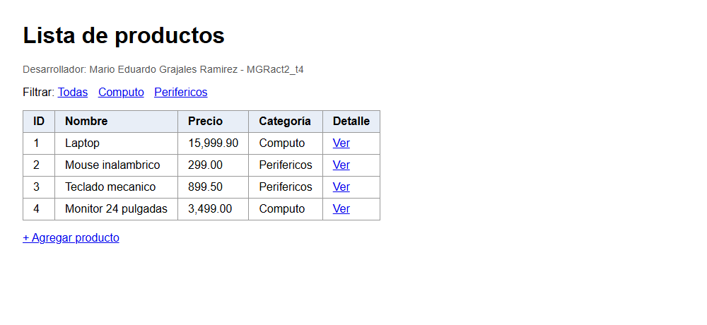
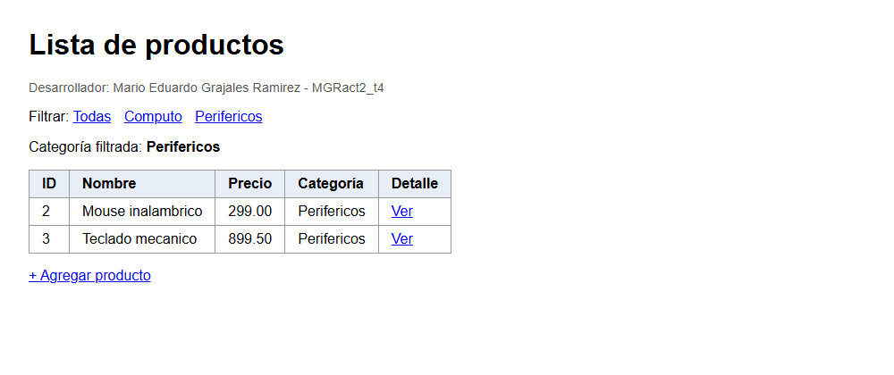
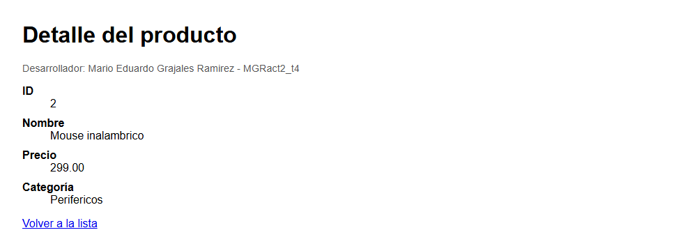
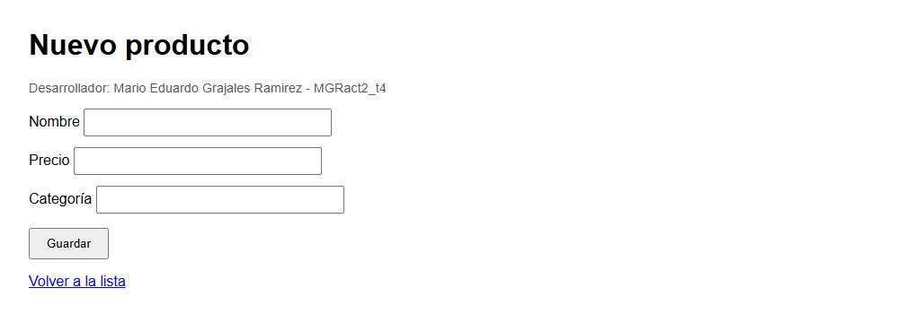
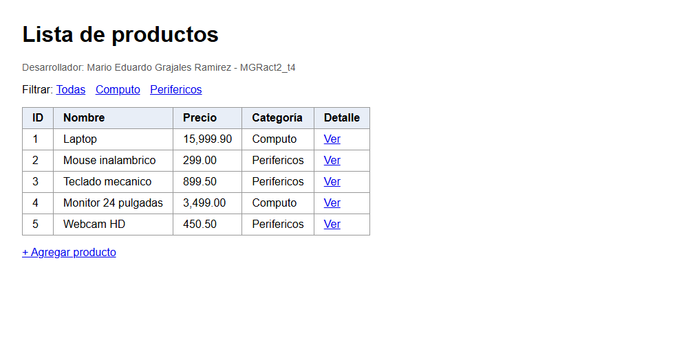
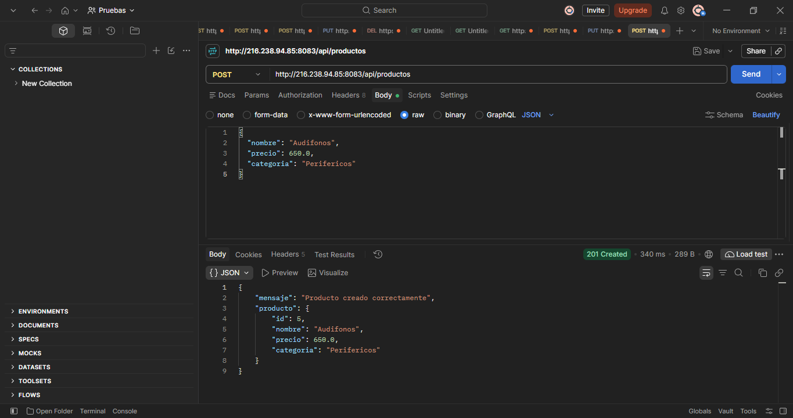

# MEGRact2_t4 — Actividad 2: Spring Boot MVC con Thymeleaf

**Autor:** Mario Eduardo Grajales Ramírez
**Tecnologías:** Java 17, Spring Boot 4.1.2, Maven, Thymeleaf, Tomcat embebido
**Puerto:** 8083

Aplicación web con patrón MVC: vistas Thymeleaf, un DTO, una propiedad personalizada leída con `@Value` y un endpoint REST POST que recibe JSON.

## Estructura

```
src/main/java/com/example/demo
├── dto/ProductoDTO.java                    # Modelo: datos que viajan entre capas
├── service/ProductoService.java            # Lista simulada en memoria
└── controller/
    ├── ProductoMvcController.java          # @Controller -> vistas Thymeleaf
    └── ProductoRestController.java         # @RestController -> JSON
src/main/resources
├── application.properties                  # server.port y app.desarrollador.nombre
└── templates/productos/                    # lista.html, detalle.html, formulario.html
```

## Endpoints

| Método | Ruta | Anotación clave | Resultado |
|---|---|---|---|
| GET | `/productos/lista` | `@RequestParam` (opcional `categoria`) | Tabla con `th:each` |
| GET | `/productos/detalle/{id}` | `@PathVariable` | Detalle de un producto |
| GET | `/productos/nuevo` | `Model` | Formulario con DTO vacío |
| POST | `/productos/guardar` | `@ModelAttribute` | Guarda y redirige a la lista |
| POST | `/api/productos` | `@RequestBody` | JSON, responde `201 Created` |

La propiedad `app.desarrollador.nombre` se inyecta con `@Value` y se muestra en todas las vistas.

## Ejecución

```bash
./mvnw spring-boot:run                      # desarrollo (puerto 8083)
./mvnw clean package                        # genera target/MEGRact2_t4.jar
java -jar target/MEGRact2_t4.jar             # ejecutar el JAR
```

Abrir: `http://localhost:8083/productos/lista`

## Capturas de pantalla

### 1. Listado con `th:each`


### 2. Filtrado con `@RequestParam` (`?categoria=Perifericos`)


### 3. Detalle con `@PathVariable` (`/productos/detalle/2`)


### 4. Formulario con `@ModelAttribute`


### 5. Formulario procesado (producto nuevo "Webcam HD" en la lista)


### 6. Petición POST con JSON en Postman (`@RequestBody`, HTTP 201)

